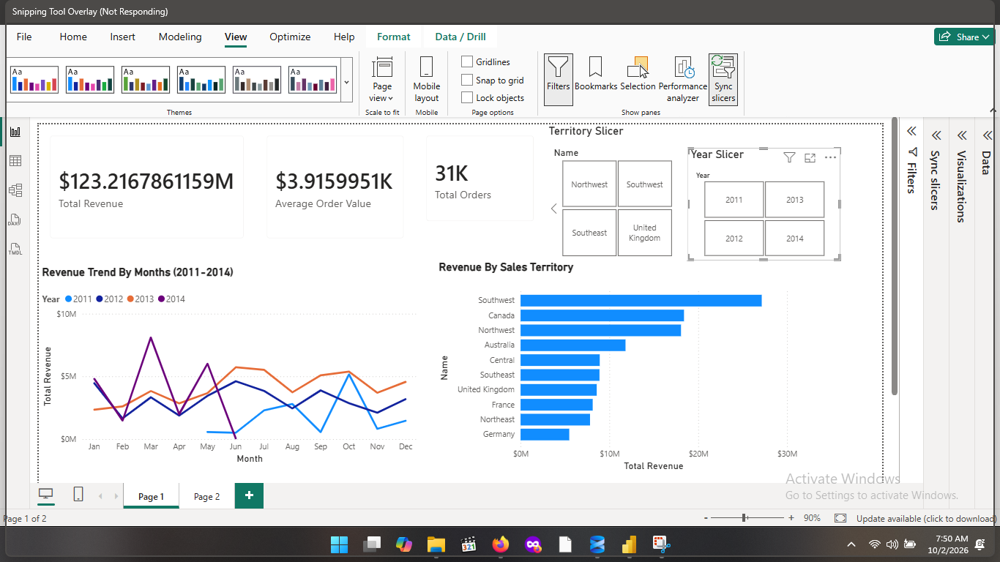
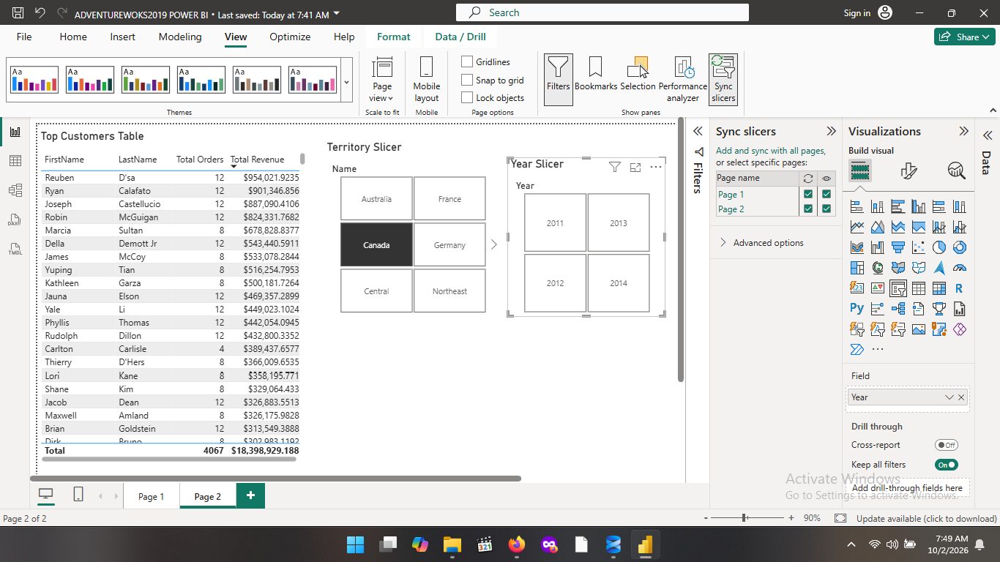
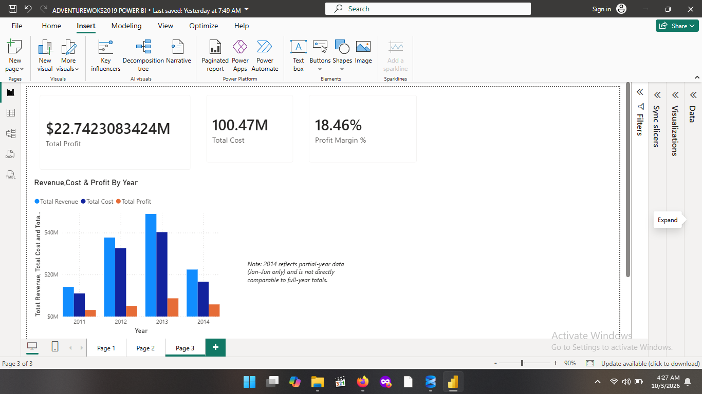
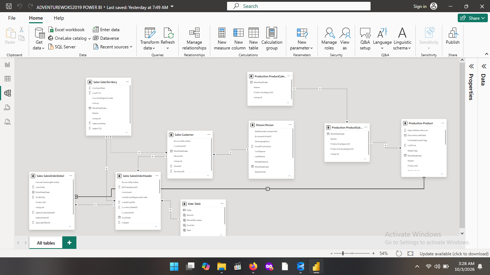

# AdventureWorks SQL & Power BI Analytics Portfolio

End-to-end analytics project on Microsoft's AdventureWorks2019 sample database: SQL for exploration and KPI analysis, then a 3-page Power BI dashboard with DAX measures built on the same data.

## My Stack

- **Database:** SQL Server 2019, AdventureWorks2019
- **IDE:** SQL Server Management Studio (SSMS)
- **BI:** Power BI Desktop, DAX
- **Version control:** Git and GitHub

## Repository Structure

- `sql/01_exploration.sql`: data profiling, NULL checks, table relationships
- `sql/02_filtering_aggregation.sql`: WHERE / GROUP BY / HAVING practice
- `sql/03_joins.sql`: INNER and LEFT JOINs across Sales, Product and Customer tables
- `sql/04_window_functions.sql`: RANK, LAG/LEAD, running totals
- `sql/05_kpis.sql`: YoY growth, AOV, customer retention, revenue concentration by territory
- `powerbi/AdventureWorks_Dashboard.pbix`: the Power BI report
- `powerbi/screenshots/`: dashboard and data model screenshots

## Power BI Dashboard

The dashboard connects directly to the SQL Server database and recreates the SQL KPIs as reusable DAX measures.

- **Page 1, Overview:** KPI cards, revenue trend by month and year, Year and Territory slicers
- **Page 2, Territory and Customers:** revenue by sales territory, top customers
- **Page 3, Profitability:** revenue vs. cost vs. profit by year

### DAX measures

- `Total Revenue`, `Total Orders`, `Average Order Value`
- `Total Cost` (SUMX over order lines using each product's standard cost)
- `Total Profit`, `Profit Margin %`
- `Revenue Prior Year`, `YoY Growth %` (time intelligence on a dedicated Date table)

## Key Findings

- Total revenue was about **$123.2M** across **31,465 orders**, an average order value of roughly **$3,900**.
- Total profit was about **$22.7M** on **$100.5M** in product cost, a margin of about **18%**.
- **Southwest** was the top sales territory by revenue, followed by Canada and Northwest.
- **2013** was the peak year for revenue, cost and profit.
- The top customer by lifetime revenue spent about **$989K** across 13 orders.
- [Add one finding from your SQL work, for example the share of one-time vs. repeat customers from `05_kpis.sql`]

## Notes and Limitations

- Order data ends on **June 30, 2014**, so 2014 is a partial year and is not comparable to full-year totals. The apparent 2014 "decline" is a data coverage artifact.
- `Total Revenue` uses the order header `TotalDue`, which includes tax and freight, and cost uses product `StandardCost` only. The profit margin is a simplified estimate, not an accounting figure.

## Future Ideas

- [ ] Publish the dashboard to Power BI Service and link it here
- [ ] Add a half-year-to-date comparison so 2014 can be compared fairly
- [ ] Turn recurring KPI queries into views or stored procedures
- [ ] Pull query results into Python (pandas) with pyodbc or SQLAlchemy
- [ ] Practice data cleaning on a messier dataset, such as a raw Kaggle CSV
- [ ] Add a query performance section (execution plans, indexing)
